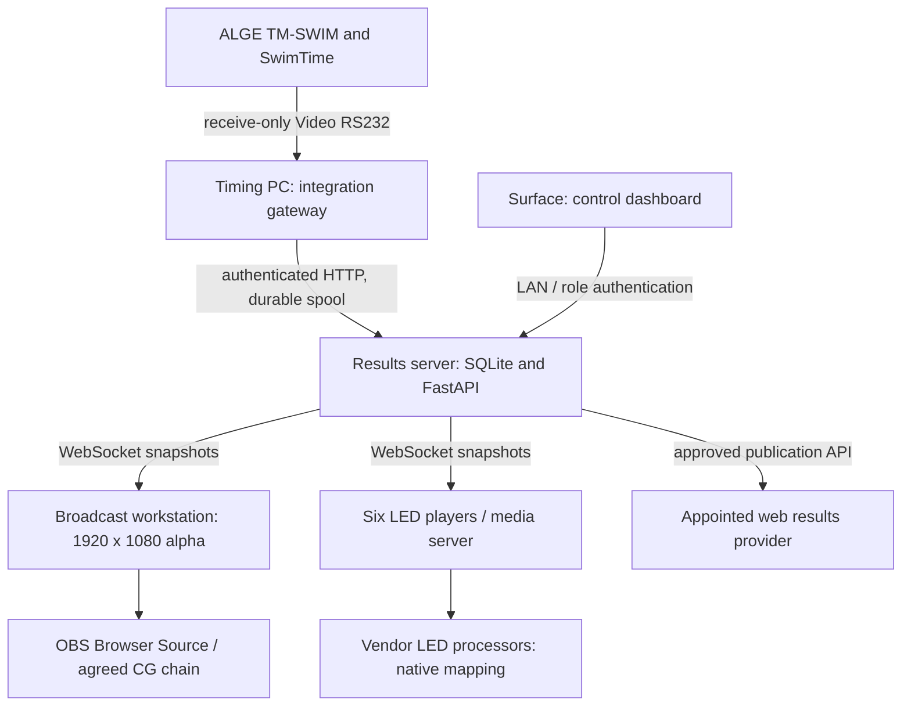

# FINS 2026 - architecture and connection plan

Release 0.6.0, 20 October 2026. Engineering build; production approval is not granted.

The Surface Laptop Go is an operator workstation. It is not assumed to have six independent video outputs. During this build, FastAPI/SQLite, the gateway and browser clients were exercised on one Linux environment using separate processes. Venue roles should be separated as follows.

A wired switch, suitable UPS protection and a separate venue VLAN are recommended. Use fixed private addresses assigned with the venue IT team. No real addresses, subnet, switch model, LED controller or processor model have been confirmed. Keep Internet access outside the competition dependency chain. Public website publication can be bridged separately through the appointed provider; it is not required to operate the local service.

| Role | Services / links | Validation still required |
|---|---|---|
| Timing computer | USB/RS232 receiver, read-only gateway, local durable spool | TM-SWIM firmware, SwimTime version, baud, connector pinout/cable and reference capture |
| Results server | Python 3.12 x64, FastAPI, SQLite WAL, HTTP/WebSocket TCP 8765 | Windows installation, storage, UPS, LAN ACL/TLS plan and full-day load |
| Surface Laptop Go | Browser control only | Operator ergonomics and actual LAN connectivity |
| Broadcast PC | OBS Browser Source to `/broadcast_tvg/`, 1920 x 1080 | OBS settings, alpha/keying, mixer chain and actual output capture |
| LED players | One browser canvas per assigned screen | EDID, output channels, pixel map, refresh, scan, orientation and physical readability |
| Public results | `/api/public/results` returns only published official results | Provider/FISU acceptance, integration contract and cross-browser/public service tests |

Six LED canvases are independent. Dimensions are width x height. Total pixels: 7,569,408.

| Output key | Physical size | Native pixels | Browser URL |
|---|---|---|---|
| master | 12m x 4m | 3072 x 1024 | `/led_displays/?screen=master` |
| l1 | 5.5m x 1m | 1408 x 256 | `/led_displays/?screen=l1` |
| l2 | 5m x 1m | 1280 x 256 | `/led_displays/?screen=l2` |
| screen2 | 7m x 3m | 1792 x 768 | `/led_displays/?screen=screen2` |
| screen3 | 6m x 4m | 1536 x 1024 | `/led_displays/?screen=screen3` |
| stage | 6m x 2m | 1536 x 512 | `/led_displays/?screen=stage` |

LED CSS preserves aspect ratio with a uniform fit; it does not force every screen to 1080p. The source canvas is native even when a preview is smaller. Actual player output resolution and processor mapping must match the assigned canvas. Confirm the physical width/height orientation with the supplier. Group routing is atomic in SQLite and playlists use the same server epoch, but browser refresh and physical video outputs are not genlocked. Hardware frame synchronisation is not claimed.

## Technical choices

React 19 / TypeScript is bundled to local static files; Node is only required to rebuild. FastAPI serves a typed OpenAPI entry point and the local API. SQLite transactions, foreign keys and WAL are used for a single controlled results writer. This release does not implement PostgreSQL, replicated servers or automatic leader failover. Migrate only after a measured deployment need and migration tests. WebSocket snapshots carry a consistent database revision, with bounded send timeouts and automatic browser reconnect. Browser clients request no CDN resources.

The read-only ALGE gateway stores each raw frame and monotonic delivery sequence in its own SQLite spool before sending. HTTP retries use a stable source ID and sequence, making duplicate delivery idempotent. Bad frames, wrong event/heat, unmapped lanes, regressive clocks, stale touches and conflicting undeleted times are quarantined. No outbound timing commands exist. Since lane messages omit event and heat, the operator must bind the gateway to the correct race; software cannot infer away a wrong physical race binding.

The database separates events, heats, athletes, universities, relay teams/members, raw messages, timing observations, proposed results, Jury decisions, approvals, output routes and audit records. Timing ticks are integer units of 1/10000 second; result ties compare hundredths per Technical Handbook p5. No automatic records, qualifications or medal awards are issued. FISU Teams are excluded from standings/medals per Handbook p6. IRM code mapping remains empty pending the governing technical rule approval.

## Failure behaviour

- A live timing observation older than two seconds is labelled DATA LOST and its live clock is suppressed.
- WebSocket failure clears the output and shows a connection warning; reconnection reloads the persisted state.
- Server restart puts existing LIVE heats into a recovery hold until another valid timing observation arrives.
- Official results cannot be changed by the gateway or graphics. Jury reopening unpublishes and revokes signatures; changed results require a new Chief and Jury sign-off.
- The gateway retains unsent raw frames on service/network loss and retries; a backlog remains visible as stale data on displays.
- Browser heartbeat means a software canvas is connected. It does not prove that an LED cabinet or broadcast mixer is displaying it.

## Interface assessment

| Interface | Evidence reviewed | Implementation / remaining work |
|---|---|---|
| TM-SWIM Video RS232 | Swimming-BE.pdf pp32-33, 19200 default / 8N1 / ASCII / CR; selectable 4800-38400 | Strict modern and legacy parsers, spool and serial receiver; PTY software test only; actual device test pending |
| SwimTime Network Display | Manual p28 configuration screenshot | Documented option, wire format and venue configuration not supplied; adapter not implemented |
| Splash / LENEX | Manual pp20,28 export/network description | Documented interchange capability; no approved field/transport contract or real file supplied; adapter not implemented |
| Hy-Tek | Manufacturer product-page attachment (image) and user requirement | No approved export sample/specification available; adapter not implemented |
| TM-SWIM PC port | Manual p33 says internal use / request | Not reverse engineered or used |

The ALGE public page was attempted but was inaccessible through web retrieval. The user-provided manufacturer PDFs were materialized and reviewed. The one-page product attachment is image-based and supplies no machine-readable wire contract. No hardware capture has been supplied.
